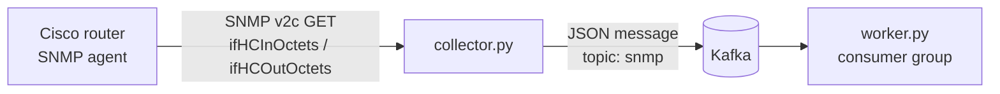

# SNMP → Kafka telemetry

Polls a router's interface traffic counters over SNMP and streams the traffic rate into Kafka, where a separate worker consumes it. A small lab project for network monitoring pipelines.



## How it works

- **`collector.py`** polls the 64-bit interface counters (`ifHCInOctets`, `ifHCOutOctets`) every few seconds, works out the in/out rate in Mbps from the difference between two readings (handling counter wrap-around), and publishes one JSON message per interval to Kafka with `acks=all`.
- **`worker.py`** is a Kafka consumer that reads those messages and prints the traffic for each interval. Start several workers in the same consumer group to share the load across partitions.

Example message:

```json
{
  "timestamp": "2026-05-12T03:14:05+00:00",
  "router_ip": "192.0.2.1",
  "interface": "FastEthernet1/1",
  "interface_index": 3,
  "in_octets": 1048576,
  "out_octets": 524288,
  "in_mbps": 0.0128,
  "out_mbps": 0.0064,
  "interval_seconds": 5.0
}
```

## Run it

You need Python 3.10+, a Kafka broker reachable on `localhost:29092` (the compose file in the companion Kafka lab works), and a router with SNMP enabled.

```bash
pip install -r requirements.txt
cp .env.example .env        # then fill in ROUTER_IP and SNMP_COMMUNITY
set -a && . ./.env && set +a

python collector.py         # terminal 1
python worker.py            # terminal 2
```

## Notes

- Lab project: SNMP v2c sends the community string in plain text. For anything beyond a lab, use SNMPv3 with authentication and privacy.
- All addresses in this README are documentation examples (RFC 5737), not real devices.
